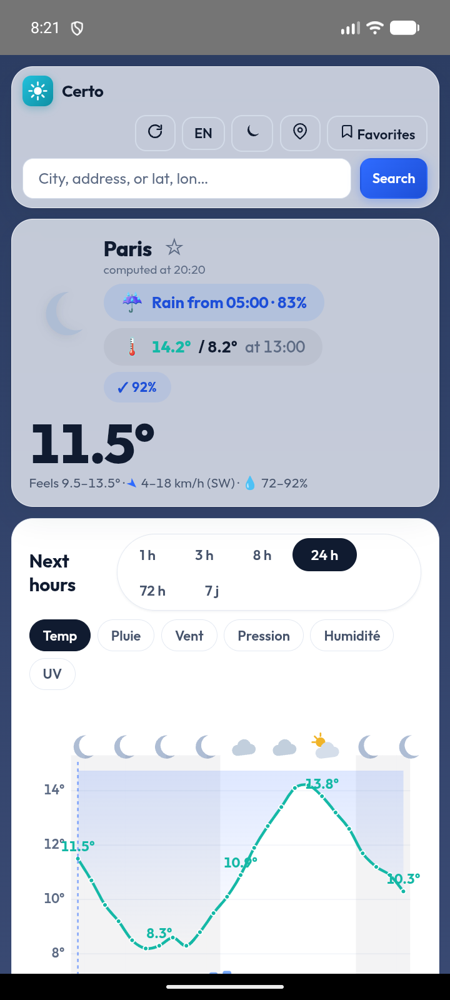
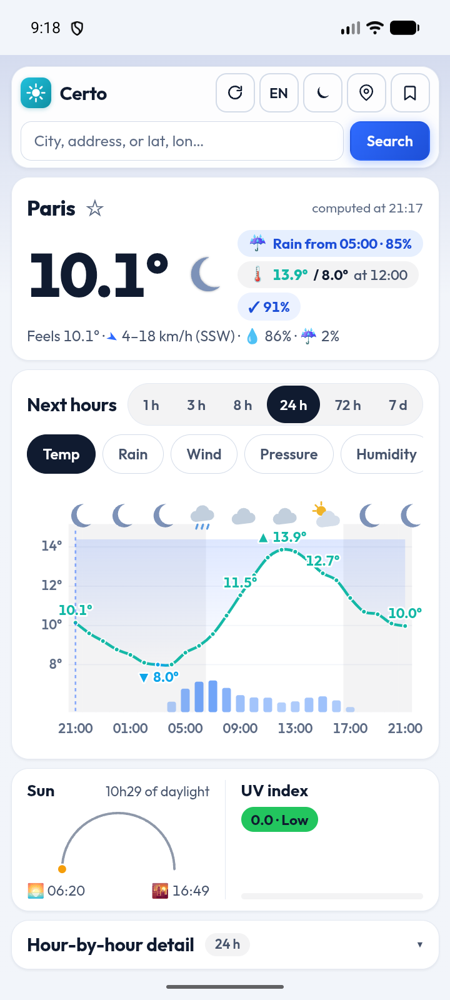
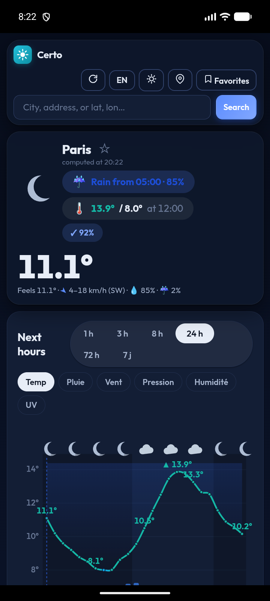
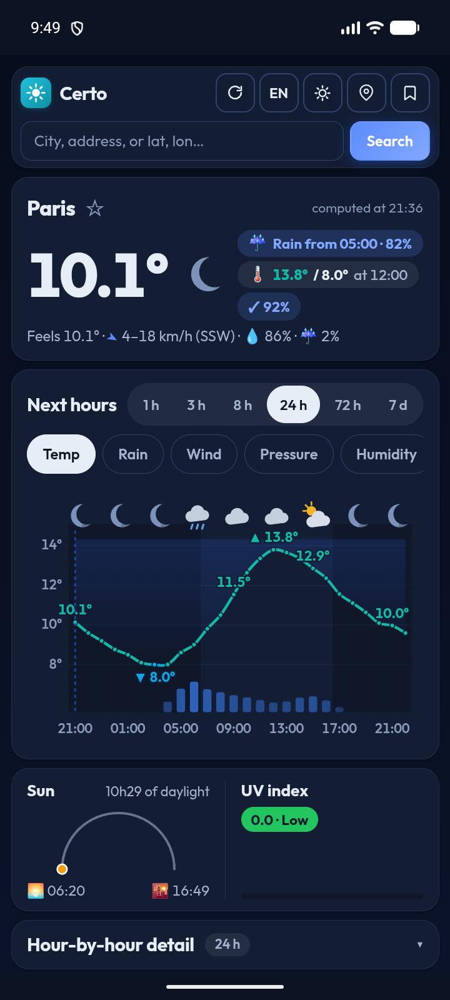
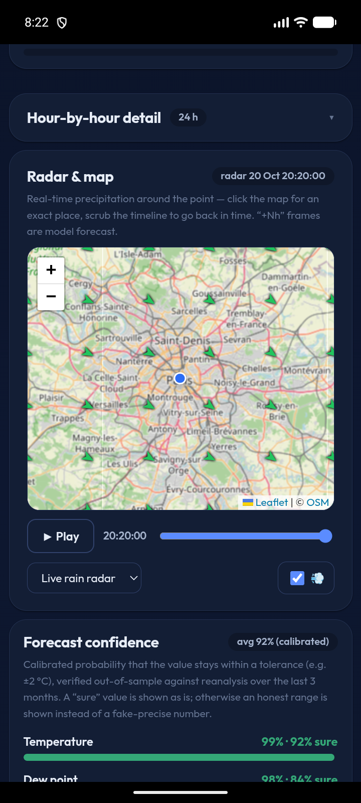
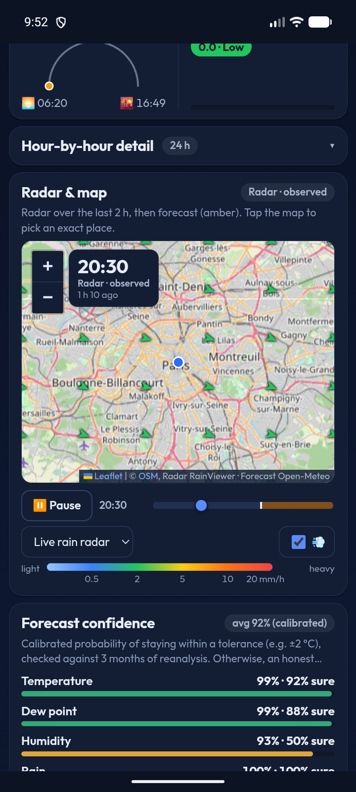
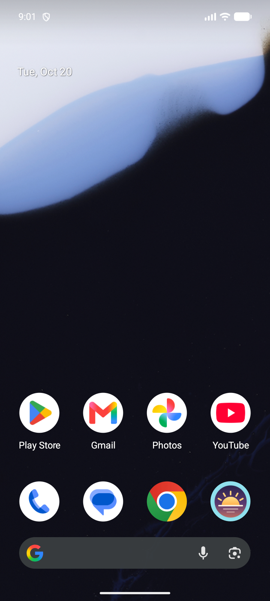

# Screenshots

Captures of the Android app and its home-screen widget, before and after the v1.6.0 changes.

- `before/`: v1.5.3.
- `after/`: v1.6.0.

Capture setup: Pixel 8 emulator, 720x1600, Paris, 20 Oct 2026. No rain that evening, so the radar shows no echoes.

## Naming

- `light-NN` / `dark-NN`: app screens in light or dark theme, numbered top to bottom of the scroll.
- `light-radar-a`, `light-radar-b`, `dark-radar-a`, `dark-radar-b`: two moments of the radar animation.
- `radar-playing`, `radar-after-interaction` (before/ only): radar animation running, and radar after a touch interaction.
- `widget-light`, `widget-dark`: home-screen widget.
- `widget-anim-1`, `widget-anim-2`: two frames of the widget animation.
- `recovery.png` (after/ only): the app after a forced WebView renderer crash (CDP `Page.crash`). The app reloads instead of closing.
- `logcat-app.txt`, `logcat-widget.txt`: logcat output captured during the session.

## Comparison

<table>
  <tr>
    <th>Screen</th>
    <th>Before (v1.5.3)</th>
    <th>After (v1.6.0)</th>
  </tr>
  <tr>
    <td>First screen, light</td>
    <td></td>
    <td></td>
  </tr>
  <tr>
    <td>First screen, dark</td>
    <td></td>
    <td></td>
  </tr>
  <tr>
    <td>Radar</td>
    <td></td>
    <td></td>
  </tr>
  <tr>
    <td>Widget</td>
    <td>not captured</td>
    <td></td>
  </tr>
</table>
